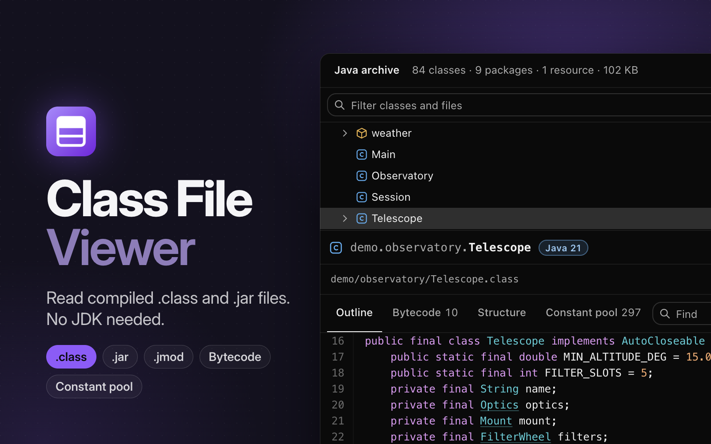

# Class File Viewer for Orca



Read compiled JVM class files in [Orca](https://orca.dev)'s editor tabs: opened from the file
tree, a file link in an agent chat, or `orca file open`. No JDK is needed and nothing leaves your
machine. Without the plugin Orca shows "Binary file — cannot display" for them.

Independent; not affiliated with Oracle, the OpenJDK project, JetBrains, Google, or the Scala and
Groovy projects. Java is a trademark of Oracle; Kotlin of JetBrains; Android of Google.

| Files                          | What opens                                                                 |
| ------------------------------ | -------------------------------------------------------------------------- |
| `.class`                       | **Class File Viewer**, the default view                                    |
| `.jmod`                        | **Class File Viewer** as a module browser, the default view                |
| `.jar`, `.war`, `.ear`, `.aar` | the same browser, as an option in the tab's view toggle: a plugin that shows them as plain archives (such as Archive Viewer) stays the default |

## A class

Four tabs:

- **Outline** — the declarations in Java syntax: package and imports, annotations with their
  values, generics from the signatures, modifiers, constant values, enum constants, records,
  sealed classes with `permits`, `module-info`. Method bodies stay compiled code: each method
  says which source lines it came from, and its name links to its bytecode. Synthetic members
  (lambdas, bridges, enum helpers) are listed as comments. In a jar, member classes are shown
  inside their outer class, and the name of another class of the jar (in an import, a
  declaration or a member's type) opens that class.
- **Bytecode** — every method listed like `javap -c -v`: descriptor, flags, stack and locals,
  instructions with the constant pool entries they use explained in comments (string constants
  written as `javap` writes them), `tableswitch` and `lookupswitch`, exception tables, line
  numbers, local variables and stack map frames. Constant pool references open the entry; jump
  targets go to the instruction; a picker jumps to a method.
- **Structure** — the class file as it is: header (size, version, flags, this and super class,
  interfaces), the field and method tables, and every attribute with its offset and length:
  inner classes, bootstrap methods, module, record components, annotations, and a hex dump of
  attributes the viewer does not decode. A field's or method's attributes open under its row.
- **Constant pool** — every entry with its type, the entries it refers to and its value, and how
  often it is used. Filter by text, `#index` or type. Selecting an entry lists what refers to it:
  other entries, instructions (with links into the bytecode) and parts of the class.

The header shows the class name, a **Java N** badge for the release it was compiled for (preview
features marked), and a badge for classes compiled by Kotlin, Scala, Groovy or Clojure. For a
Kotlin class the Structure tab gives its Kotlin kind (class, file facade, multi-file part…) and
the version of its `@Metadata`, which is the metadata format's version, not the compiler's
(Kotlin 1.3.72 writes 1.1.16). Find (`⌘F` / `Ctrl+F`) works in the Outline
and Bytecode tabs; **Copy** puts the tab's text on the clipboard, and **Save…** writes the
outline as `Name.java` or the listing as `Name.javap.txt`.

Odd and broken files get a clear message instead of a blank tab:

- a class newer than the viewer knows (above class file version 71, Java 27) is shown as far as
  the known format goes, with a notice;
- a damaged or cut-off class shows everything read before the damage and says where reading
  stopped and why; a damaged attribute (a method's code, say) is named in a notice, and the
  rest of the class still shows;
- a file that is not a class shows its first bytes in hex, and a jar saved as `.class` is
  recognised as a ZIP archive;
- obfuscated names stay readable: invisible, control and right-to-left characters are shown as
  escapes (`\t`, `\u200b`) wherever a name appears, with a notice. A space inside a name, as in
  Kotlin test names, stays a space.

## A jar

- **Packages** as a tree, compacted until they branch (`com.example.app`), with class counts;
  nested and anonymous classes under their outer class; resources and other files in folders.
- **Class roots** of web and Spring Boot archives (`WEB-INF/classes`, `BOOT-INF/classes`) and of a
  `.jmod` (`classes/`) are shown as their own trees.
- **Multi-release jars**: each `META-INF/versions/N` copy is attached to its class, with a switch
  between the versions.
- **Archives inside**: `WEB-INF/lib/*.jar`, `BOOT-INF/lib/*.jar` and an Android library's
  `classes.jar` open in place (`Enter`), with a trail back.
- **Overview**: counts of classes, packages and resources, a chart of the Java versions the
  classes are compiled for, the module name (a `.jmod`'s from `classes/module-info.class`; from
  `META-INF/versions/N` when a multi-release jar keeps its `module-info` only there),
  `Main-Class` as a link, other key manifest attributes, multi-release versions and the archives
  inside.
- **Entries as the JVM takes them**: the central directory `java.util.zip` reads (when an archive
  holds another one a different tool could read, a notice says so), entries by their exact
  stored names, the last copy of a name winning. Names the JVM never looks up (with `..`, `.`,
  `\` or a leading `/`), the earlier copies of a name, and entries named like folders that hold
  data are listed apart under **Unusual entries**, with a notice, so a crafted jar cannot show a
  decoy in place of the class that runs. The JVM reads `a/B.class/` as `a/B.class` when no entry
  has that name, and so does the viewer. The manifest is the one `java.util.jar` (Java 21) reads:
  the last `META-INF/MANIFEST.MF` in any capitals, with a hint when `java -jar` would not find it;
  version folders count only as the JVM names them (`versions/11`, not `versions/011`).
- Selecting a class opens it with the four tabs above. Selecting a file previews it: text with
  the manifest and `.properties` keys and `.java` sources highlighted, images, or a hex dump;
  **Save…** writes the file through Orca's save dialog.

## Keyboard

| Key                                   | Action                                                       |
| ------------------------------------- | ------------------------------------------------------------ |
| `↑` `↓` (`PageUp` `PageDown` `Home` `End`) | Previous / next row of the tree                          |
| `→` `←`                               | Open / close a package, go to its first row / to the parent  |
| `Enter`                               | Open an archive inside; open or close a package              |
| `Esc`                                 | Clear the filter, back out of an archive inside, clear the selection |
| `Backspace`                           | Back out of an archive inside                                |
| `⌘F` / `Ctrl+F`                       | Find in the tab, or filter the tree                          |
| `⌘G` / `F3` (with `Shift`: back)      | Next match                                                   |

## Limits

- Orca hands files of up to about 50 MiB to plugin editors. For a larger file it shows its own
  "File too large" message in the tab, and the plugin never receives the file. Near the limit
  the viewer stays quick: a 49 MiB jar with about 12,000 classes opens in under a second, and the
  overview's version chart fills in while you browse. Classes are read when you select them.
- Archives inside open up to 64 MiB each and 4 levels deep; text previews show the first 2 MiB,
  images up to 16 MiB, and other files the first 4 KiB in hex. Code lines are cut at 4,000
  characters on screen. Classes read only for the Outline's names are limited to 1 MiB each, and
  one class's views unpack at most 64 MiB of them. Folders more than 128 levels deep are shown as
  one.
- The Bytecode tab lists up to 1,000,000 instructions and table rows per class; past that, the
  remaining methods keep their declaration and flags, their code is left out, and a notice says
  so. The Constant pool searches the same instructions for uses. A method whose code is longer
  than 65,535 bytes, which the JVM rejects, is shown as damaged.
- ZIP entries that are encrypted or use methods other than stored and Deflate (jars never do) are
  listed but not read.
- Orca opens an empty file in its own text editor, so the viewer's "file is empty" message is not
  seen there.
- The Outline is not a decompiler: method bodies are shown as bytecode, not as Java statements.
  Full decompilation is planned for a later version; `src/decompiler/` is the place for it.
- Android `.dex` files are not read; an `.aar`'s `classes.jar` is.

## Privacy

Read-only and offline: no capabilities, no network, nothing in the file is run, and the file is
never modified. The last tab and the tree's width are remembered in the tab's own storage, on
this machine only.

## Install

From the catalog: Orca → Settings → Plugins → ⋯ → **Catalog sources…** → add
`https://github.com/Sergei-Popov/orca-plugin.git`, then install **Class File Viewer**.

From source:

```sh
git clone https://github.com/Sergei-Popov/orca-class-viewer.git
orca plugin dev load ./orca-class-viewer   # prints the access it needs and an --approve fingerprint
```

## Develop

No build step: Orca transpiles the TypeScript in `src/` on load.

```sh
orca plugin dev watch . --check   # load, reload on save, stream logs
orca plugin test .                # unit tests (src/**/*.test.ts)
npx -p typescript tsc -p .        # type check, after `orca plugin types .`
orca plugin validate .
orca plugin shot local.class-viewer --editor path/to/Some.class   # PNG of the editor
```

- `src/editor.ts` — the custom editor entry: bytes from Orca → class or jar view.
- `src/classfile/` — the class file reader: constant pool, attributes, descriptors and generic
  signatures, names, flags, versions, the language a class came from, the outline and the
  constant pool's usage index. Everything is DOM-free and tested.
- `src/bytecode/` — the opcode table, the disassembler and the `javap`-style listing.
- `src/zip/` — the ZIP reader, a DEFLATE decoder and CRC-32, written for this plugin (the ZIP
  reading follows Archive Viewer's).
- `src/jar/` — the jar model (packages, class roots, nested classes, multi-release versions,
  archives inside, entries listed apart), the manifest parser and the budgeted cache of classes
  read to resolve names.
- `src/ui/` — the views, styles, icons and the Java highlighter; `src/i18n.ts` holds the English
  and Russian strings.
- `src/decompiler/` — the boundary for a decompiler; none is bundled yet.
- `src/testing/` — builders for the tests: class files and ZIP archives are written byte by byte
  in code, so the repository holds no `.class` or `.jar` files.

Branches follow git-flow: `feature/*` from `develop`, releases through `release/x.y.z` into
`main`, tagged `vX.Y.Z`. Only the maintainers push and open pull requests.

## License

MIT © Sergei Popov. The plugin bundles no third-party code.
